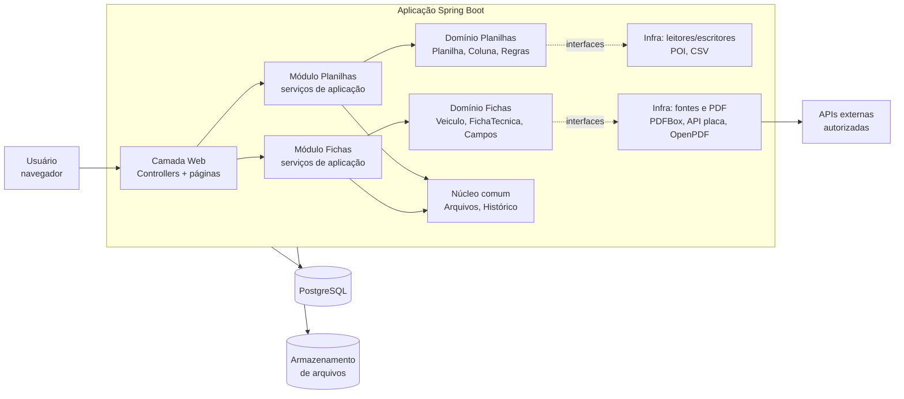
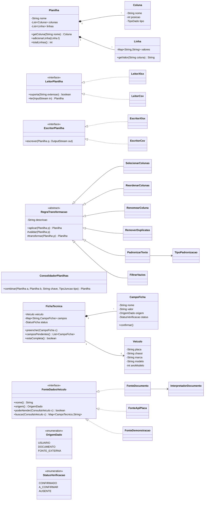
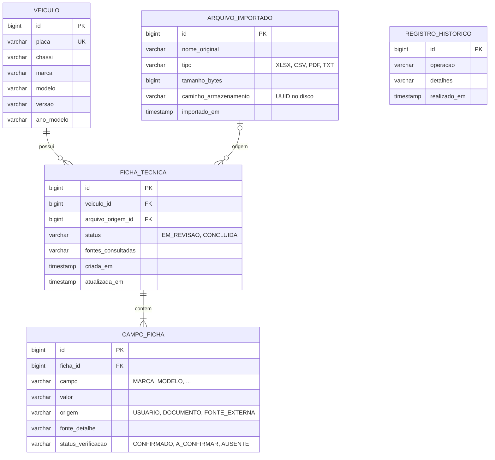

# SDD — DataFlow Auto

> **Software Design Document** · Plataforma Inteligente de Automação de Dados
> Status: **MVP implementado (v0.2)** · Última atualização: 18/10/2026
> Documento dinâmico: será atualizado a cada sprint até o MINT (16/11 a 19/11). Todas as decisões registradas aqui são de responsabilidade da equipe de desenvolvimento.

---

## 1. Identificação

| Campo | Valor |
|---|---|
| Projeto | DataFlow Auto (nome provisório; alternativas: PlanilhaPro, AutoData, DataFlow Intelligence) |
| Subtítulo | Plataforma inteligente para organização de planilhas e fichas técnicas automotivas |
| Cliente | _a preencher (ex.: concessionária / setor administrativo)_ |
| Integrantes | _a preencher_ |
| Orientador | _a preencher_ |
| Instituição | Unimetrocamp · LTD |
| Repositório | _a preencher (link do GitHub)_ · instruções de execução no `README.md` |

## 2. Problema (a dor do cliente)

Equipes administrativas e de concessionárias gastam muitas horas organizando planilhas manualmente: copiando colunas, cruzando dados de arquivos diferentes por CPF ou placa, removendo duplicatas e corrigindo formatos. O mesmo acontece no preenchimento de fichas técnicas de veículos, em que os dados ficam espalhados entre documentos, sistemas e sites, e são redigitados campo a campo.

Consequências: retrabalho, erros de digitação, dados inconsistentes e tempo operacional alto.

## 3. Escopo

### 3.1 Objetivo
Uma aplicação web que centraliza duas funcionalidades:
1. **Organização e consolidação automatizada de planilhas.**
2. **Geração assistida de fichas técnicas automotivas.**

O público-alvo são usuários sem conhecimento técnico avançado, então a interface deve ser simples e guiada.

### 3.2 MVP (entrega para o MINT)
- Importar planilhas XLSX e CSV e visualizar os dados.
- Selecionar, reordenar e renomear colunas.
- Combinar duas planilhas por um campo comum (CPF, código, placa etc.).
- Detectar duplicatas e campos vazios.
- Pré-visualizar e exportar a planilha final (XLSX/CSV).
- Preencher uma ficha técnica a partir de dados digitados pelo usuário ou extraídos de um documento de exemplo (PDF com texto).
- Indicar a origem de cada campo da ficha (usuário, documento, fonte externa) e o que falta confirmar.
- Revisar manualmente e gerar a ficha em PDF.

### 3.3 Fora do MVP (evolução futura)
- Consulta automatizada por placa (depende de API autorizada e contratada).
- OCR de documentos digitalizados (imagens).
- Modelos reutilizáveis de transformação e processamento em lote.
- IA para sugerir correspondência entre colunas e apontar inconsistências.
- Grandes volumes de dados e novos formatos de arquivo.

### 3.4 Premissa importante sobre dados de veículos
Consultar uma placa **não** garante acesso às especificações técnicas completas; isso depende da base de dados, da API contratada e das permissões. O sistema usa apenas fontes disponíveis e autorizadas e **nunca apresenta como confirmado um dado não verificado**. Cada campo da ficha carrega sua origem e seu status de verificação.

## 4. Requisitos

### 4.1 Requisitos funcionais

| ID | Requisito | Módulo | Prioridade | MVP |
|---|---|---|---|---|
| RF01 | Importar arquivos XLSX e CSV | Planilhas | Alta | Sim |
| RF02 | Visualizar os dados importados antes do processamento | Planilhas | Alta | Sim |
| RF03 | Selecionar, reordenar e renomear colunas | Planilhas | Alta | Sim |
| RF04 | Combinar duas ou mais planilhas por um campo-chave escolhido pelo usuário | Planilhas | Alta | Sim |
| RF05 | Identificar duplicatas, campos vazios e inconsistências | Planilhas | Média | Sim |
| RF06 | Aplicar regras de padronização (maiúsculas, trim, formato de CPF, CNPJ, placa, telefone e data) | Planilhas | Média | Sim |
| RF07 | Pré-visualizar o resultado | Planilhas | Alta | Sim |
| RF08 | Exportar a planilha final em XLSX ou CSV | Planilhas | Alta | Sim |
| RF09 | Salvar e reutilizar regras de organização | Planilhas | Baixa | Não |
| RF10 | Criar ficha técnica a partir de dados informados pelo usuário | Fichas | Alta | Sim |
| RF11 | Extrair dados de um documento enviado (PDF com texto) | Fichas | Média | Sim |
| RF12 | Consultar veículo por placa em fonte autorizada | Fichas | Baixa | Interface pronta + base de demonstração |
| RF13 | Indicar origem e status de verificação de cada campo | Fichas | Alta | Sim |
| RF14 | Editar e confirmar campos manualmente | Fichas | Alta | Sim |
| RF15 | Gerar a ficha técnica em PDF | Fichas | Alta | Sim |
| RF16 | Registrar histórico das operações | Geral | Média | Sim |
| RF17 | Autenticação simples de usuário | Geral | Média | Sim (área da equipe) |
| RF18 | Site público da loja com catálogo, busca, filtros e ordenação | Loja | Alta | Sim |
| RF19 | Anunciar carro a partir de ficha técnica concluída (preço, km, fotos, destaque) | Loja | Alta | Sim |
| RF20 | Página do carro com ficha técnica confirmada, PDF e simulação de financiamento | Loja | Alta | Sim |
| RF21 | Receber contatos de interessados (dúvida, test drive, proposta, financiamento) | Loja | Alta | Sim |
| RF22 | Controlar custos por carro (compra + despesas) e calcular lucro e margem | Loja | Alta | Sim |
| RF23 | Importar despesas de planilha XLSX/CSV ligando cada linha ao carro pela placa | Loja + Planilhas | Média | Sim |
| RF24 | Registrar e desfazer venda, ligando ao interessado | Loja | Alta | Sim |
| RF25 | Painel com indicadores e relatórios XLSX de estoque, despesas e vendas | Loja | Média | Sim |

### 4.2 Requisitos não funcionais

| ID | Requisito |
|---|---|
| RNF01 | Interface responsiva e intuitiva, com mensagens de erro claras. |
| RNF02 | Validação de tipo, extensão e tamanho dos arquivos enviados (limite inicial: 10 MB). |
| RNF03 | Arquivos e dados importados protegidos: armazenamento fora da pasta pública e acesso apenas pelo dono. |
| RNF04 | Separação entre interface, regras de negócio e persistência. |
| RNF05 | Testes automatizados das principais regras de negócio (meta: ≥ 70% de cobertura no domínio). |
| RNF06 | Documentação técnica e instruções de execução no README. |
| RNF07 | Ambiente reprodutível com Docker Compose (aplicação + PostgreSQL). |

## 5. Tecnologias

| Camada | Escolha | Motivo |
|---|---|---|
| Linguagem | Java 21 | Foco da disciplina em POO; tipagem forte e interfaces claras. |
| Framework | Spring Boot 3.4 (Web, Thymeleaf, Data JPA, Validation) | Injeção de dependências facilita trocar implementações de interfaces. |
| Planilhas | Apache POI (XLSX) e Apache Commons CSV | Bibliotecas maduras para leitura e escrita. |
| Documentos | Apache PDFBox (leitura de PDF); Tesseract via Tess4J (OCR, futuro) | Extração de texto de documentos. |
| Geração de PDF | OpenPDF | Ficha técnica pronta para impressão. |
| Banco de dados | PostgreSQL 16 + Flyway | Relacional, com migrações versionadas. |
| Front-end | Thymeleaf + HTML, CSS e JavaScript puro; React como evolução | Menor curva para o MVP; as telas funcionam mesmo sem JavaScript. |
| Testes | JUnit 5, AssertJ, MockMvc, H2 em memória | Unidade das regras de negócio e integração dos fluxos web. |
| Build e execução | Maven (com wrapper), Docker Compose; perfil `local` com H2 | Execução igual em todas as máquinas, inclusive sem Docker. |
| Gestão | GitHub Projects (4 sprints), issues, PRs | Exigência da disciplina. |

## 6. Arquitetura

### 6.1 Visão geral
Monólito modular em camadas, com dois módulos de negócio independentes e um núcleo compartilhado. As regras de negócio (domínio) não dependem da interface nem do banco: dependem apenas de interfaces, cujas implementações concretas ficam na camada de infraestrutura (ideia da arquitetura hexagonal, simplificada).



### 6.2 Estrutura de pacotes

```
br.com.dataflowauto
├── comum
│   ├── dominio        (ArquivoImportado, RegistroHistorico, TipoArquivo, TipoOperacao, exceções)
│   ├── aplicacao      (ArmazenamentoService, HistoricoService)
│   ├── infra          (repositórios JPA)
│   └── web            (HomeController, TratadorErros)
├── planilhas
│   ├── dominio        (Planilha, Coluna, Linha, ConsolidadorPlanilhas, AnalisadorQualidade,
│   │                   RelatorioQualidade, TipoJuncao, LeitorPlanilha, EscritorPlanilha)
│   │   └── regras     (RegraTransformacao e subclasses, TipoPadronizacao)
│   ├── aplicacao      (PlanilhaService)
│   ├── infra          (LeitorXlsx, LeitorCsv, EscritorXlsx, EscritorCsv)
│   └── web            (PlanilhaController, AreaTrabalho, OrganizacaoForm)
└── fichas
    ├── dominio        (FichaTecnica, CampoFicha, Veiculo, Placa, CampoTecnico, GrupoCampo,
    │                   OrigemDado, StatusVerificacao, StatusFicha, ConsultaVeiculo,
    │                   FonteDadosVeiculo, InterpretadorDocumento)
    ├── aplicacao      (FichaService, NovaFichaComando)
    ├── infra          (FonteDocumento, FonteApiPlaca, FonteDemonstracao, ExtratorTextoDocumento,
    │                   GeradorFichaPdf, repositórios JPA)
    └── web            (FichaController, RevisaoForm)
```

### 6.3 Fluxos principais

**Organizar e combinar planilhas**
1. Usuário envia um ou mais arquivos → `PlanilhaService` valida (extensão, tamanho e assinatura do conteúdo) e escolhe o `LeitorPlanilha` pelo formato.
2. Os dados viram objetos `Planilha` e são exibidos para pré-visualização.
3. Usuário escolhe colunas, ordem, nomes, chave de junção e regras.
4. `PlanilhaService` aplica a lista de `RegraTransformacao` e o `ConsolidadorPlanilhas`; cada etapa gera uma nova `Planilha`. A `AreaTrabalho` da sessão guarda a planilha de partida, a atual e cada etapa como uma operação que pode ser refeita (padrão Command). Desfazer é reaplicar, a partir da partida, as etapas que sobraram (até 20), em vez de guardar uma cópia por etapa. Cada planilha aberta ganha um identificador que vai nos formulários, para que uma aba antiga não altere nem exporte a planilha aberta em outra aba. Planilhas lidas e resultados de combinação têm teto de 200 mil linhas, e as últimas 4 planilhas lidas ficam em cache.
5. O resultado é gravado com o `EscritorPlanilha` do formato escolhido; cada operação vai para o histórico.

**Preencher ficha técnica**
1. Usuário informa a placa ou envia um documento.
2. `FichaService` registra primeiro o que o usuário informou e depois consulta, em ordem, as `FonteDadosVeiculo` disponíveis (documento, API autorizada, base de demonstração). A primeira fonte que traz um campo tem prioridade.
3. Cada valor encontrado vira um `CampoFicha` com `OrigemDado` e `StatusVerificacao`.
4. A tela destaca campos ausentes ou não confirmados; o usuário revisa e confirma.
5. `GeradorFichaPdf` gera o PDF somente com a ficha revisada.

**Vender um carro (loja)**
1. A equipe escolhe uma ficha concluída e cria o `Anuncio` (preço, km, valor de compra, fotos). O anúncio lê marca, modelo, motor e câmbio da ficha.
2. O carro aparece no site público (`LojaController`), com filtros (`FiltroLoja`), ficha técnica confirmada e `SimulacaoFinanciamento`.
3. O visitante envia uma `Proposta` (dúvida, test drive, proposta ou financiamento).
4. A equipe lança `Despesa`s ou importa uma planilha; `Rentabilidade` calcula custo total, lucro e margem.
5. A venda (`Venda`, embutida no anúncio) tira o carro da loja, marca o interessado como "virou venda" e entra nos indicadores e relatórios.

## 7. Modelo de domínio e POO

### 7.1 Entidades principais
- **Usuario** (evolução): quem usa o sistema e é dono dos arquivos. No MVP há um usuário da equipe configurado por variável de ambiente.
- **Anuncio**: carro à venda; referencia a `FichaTecnica`, guarda preço, km, custo de compra, fotos, situação e a `Venda`.
- **Despesa**: custo de um carro (categoria, valor, data e origem: manual ou planilha).
- **Proposta**: contato de um interessado pela loja, com tipo e situação.
- **ArquivoImportado**: arquivo enviado (nome, tipo, tamanho, caminho, data).
- **Planilha**: conjunto de `Coluna` e `Linha` lido de um arquivo.
- **Coluna** e **Linha**: estrutura e dados da planilha.
- **RegraTransformacao**: abstração de uma regra aplicada à planilha.
- **ModeloOrganizacao**: conjunto salvo de regras para reutilizar (futuro).
- **Veiculo**: placa, chassi, marca, modelo, versão, ano.
- **FichaTecnica**: ficha de um veículo com seus campos e status.
- **CampoFicha**: nome, valor, origem e status de verificação.
- **RegistroHistorico**: operação realizada, por quem e quando.

### 7.2 Diagrama de classes (núcleo)



### 7.3 Onde cada princípio de POO aparece

| Princípio | Onde | Exemplo |
|---|---|---|
| Encapsulamento | `Planilha`, `FichaTecnica`, `CampoFicha` | Atributos privados; uma ficha só muda de status por métodos como `confirmar()` e `preencher()`, nunca por atribuição direta. |
| Abstração | `RegraTransformacao`, `FonteDadosVeiculo` | O serviço sabe *o que* uma regra faz (`aplicar`), não *como*. |
| Herança | Subclasses de `RegraTransformacao` | `RemoverDuplicatas` e `PadronizarTexto` reaproveitam a descrição e o contrato da classe-mãe. |
| Interfaces | `LeitorPlanilha`, `EscritorPlanilha`, `FonteDadosVeiculo` | Novos formatos e novas fontes entram sem mudar os serviços. |
| Polimorfismo | `List<RegraTransformacao>` e `List<FonteDadosVeiculo>` | `regras.forEach(r -> planilha = r.aplicar(planilha))` executa o comportamento de cada tipo. |
| Responsabilidade única | Serviços separados | Importar, organizar, exportar e gerar PDF são classes distintas. |
| Inversão de dependência | Domínio depende de interfaces | O Spring injeta `LeitorXlsx` ou `LeitorCsv`; o domínio não conhece Apache POI. |

Padrões de projeto usados: **Template Method** (`RegraTransformacao.aplicar` chama `validar` e `transformar`), **Strategy** (regras, leitores, escritores e `TipoPadronizacao`, em que cada constante do enum carrega sua função), **Chain of Responsibility** simplificada (fontes de veículo consultadas em ordem com `@Order`), **Repository** (persistência), **Command** (etapas da `AreaTrabalho`, reaplicadas para desfazer) e **objetos imutáveis** (`Planilha`, `Linha`, `Coluna`, `Placa`), que tornam o desfazer trivial.

## 8. Modelo de banco de dados

Os dados das planilhas em si não são gravados linha a linha no banco: o arquivo original e o resultado ficam no armazenamento de arquivos, e o banco guarda metadados, regras, fichas e histórico.



Previstas para evolução: `USUARIO` (login), `MODELO_ORGANIZACAO` e `REGRA` (regras reutilizáveis, com parâmetros em `jsonb`).

Campos previstos na ficha técnica: marca, modelo, versão, ano de fabricação/modelo, motorização, potência, torque, câmbio, tração, combustível, consumo, dimensões (comprimento, largura, altura, entre-eixos), porta-malas, tanque, peso e equipamentos de série.

## 9. Decisões técnicas (ADRs resumidos)

| # | Decisão | Alternativas | Motivo |
|---|---|---|---|
| D01 | Java + Spring Boot | Python (pandas, openpyxl) | Demonstra melhor POO, que é o foco da disciplina; Python seria mais rápido para planilhas e OCR. |
| D02 | Monólito modular | Microsserviços | Equipe pequena e prazo curto; módulos podem ser separados no futuro. |
| D03 | Domínio isolado por interfaces | Lógica nos controllers | Facilita testes e troca de bibliotecas. |
| D04 | Planilhas em arquivo, metadados no banco | Gravar todas as linhas no banco | Planilhas têm colunas variáveis; o banco ficaria complexo sem ganho no MVP. |
| D05 | Consulta por placa como interface com implementação *mock* no MVP | Integrar uma API paga já no MVP | Depende de contrato e autorização; a interface permite plugar a API real depois. |
| D06 | Cada campo da ficha guarda origem e status | Ficha com valores simples | Atende à regra de nunca apresentar dado não verificado como confirmado. |
| D07 | Front em Thymeleaf/HTML no MVP | React desde o início | Menos infraestrutura; React fica como evolução. |
| D08 | PostgreSQL + Flyway | MySQL, H2 | Robusto, suporta `jsonb` para parâmetros das regras futuras; H2 nos testes e no perfil `local`. |
| D09 | Login só para a área da equipe (Spring Security, usuário configurado por variável de ambiente) | Sem login; cadastro de usuários no banco | Com o site público, painel e dados de clientes não podem ficar abertos. Um usuário configurável basta para o MVP; cadastro de usuários e perfis fica como evolução. |
| D10 | Planilha em edição fica na sessão, imutável a cada etapa | Gravar cada versão no banco | Simples, rápido e permite desfazer; o arquivo original continua guardado. |
| D11 | Validar a assinatura do arquivo, além da extensão | Confiar só na extensão | Impede, por exemplo, um executável renomeado para `.xlsx`. |
| D13 | Anúncio só a partir de ficha técnica concluída; a loja mostra apenas campos confirmados | Cadastro livre do carro no anúncio | Reaproveita o módulo de fichas e mantém a regra de nunca publicar dado não verificado. Se a ficha voltar para revisão, o carro sai da loja. |
| D14 | Fichas não dependem da loja: `VerificadorUsoFicha` (interface) implementada pelo módulo de vendas | FichaService consultar anúncios diretamente | Inversão de dependência; evita ciclo entre módulos. |
| D15 | Importação de despesas reaproveita `LeitorXlsx`/`LeitorCsv` e exporta no mesmo formato | Leitor específico | Liga a loja ao módulo de planilhas e à planilha de Controle de Despesas; a exportação pode ser reimportada. |
| D16 | Valores em `BigDecimal`; simulação pela Tabela Price | `double` | Evita erro de arredondamento em dinheiro. |
| D12 | CSV exportado com `;`, UTF-8 com BOM e proteção contra fórmulas | CSV com vírgula | É o formato que o Excel em português abre corretamente; a proteção evita injeção de fórmulas. |

## 10. Segurança e privacidade
- Planilhas podem conter dados pessoais (CPF, nome, endereço): tratar conforme a LGPD, sem expor arquivos por URL pública.
- Upload grande demais mostra os limites reais (lidos da configuração); outras falhas de upload vão para o log com a causa, em vez de virar "arquivo grande". A pasta de trabalho do Tomcat fica em `./dados/tomcat` (`DATAFLOW_TOMCAT_DIR`), e não em `/tmp`, que o sistema operacional limpa.
- Validar extensão, tamanho e os primeiros bytes do conteúdo antes de processar; só XLSX, CSV, PDF e TXT são aceitos (arquivos com macro, como `.xlsm`, são recusados).
- Valores exportados em CSV que começam com `=`, `+`, `-` ou `@` recebem um apóstrofo para não virarem fórmula.
- Área da equipe exige login; senha guardada com BCrypt na memória, definida por `DATAFLOW_ADMIN_SENHA` (o sistema avisa no log se a senha padrão estiver em uso).
- Contra força bruta: depois de 5 senhas erradas seguidas do mesmo IP para o mesmo usuário em 15 minutos, esse par fica bloqueado por 15 minutos, mesmo com a senha certa (`ControleTentativasLogin`, conferido antes da senha por `FiltroBloqueioLogin`). Cada falha vai para o log com IP e usuário. Os contadores ficam em memória.
- Proteção CSRF em todos os formulários (inclusive o de contato público) e cabeçalho Content-Security-Policy sem scripts inline.
- Fotos validadas pela assinatura (JPG, PNG, WEBP), até 5 MB, salvas com nome UUID fora da pasta pública; o nome é validado antes de abrir o arquivo.
- A página pública não mostra placa completa, chassi, custos nem dados de clientes.
- Integridade: cada carro tem no máximo um anúncio em andamento (não vendido), garantido também pelo banco (coluna única `anuncio.veiculo_em_andamento_id`, migração V6). `Anuncio`, `FichaTecnica` e `Proposta` têm `@Version`: se duas pessoas gravarem o mesmo registro ao mesmo tempo, a segunda recebe um aviso em vez de sobrescrever a primeira.
- Chaves de API em variáveis de ambiente, nunca no repositório.

## 11. Testes
116 testes automatizados (`./mvnw test`), todos passando. Por padrão rodam em H2 (modo PostgreSQL); com `./mvnw verify -Ppostgres` os mesmos testes rodam num PostgreSQL 16 via Testcontainers, e o CI roda as duas versões.
- Unidade: cada `RegraTransformacao` e cada `TipoPadronizacao`, `ConsolidadorPlanilhas` (junções interna, à esquerda e completa), `AnalisadorQualidade`, leitores e escritores (ida e volta XLSX/CSV, codificação, separador, fórmulas), `FichaTecnica` (status, prioridade de fontes, conclusão), `Placa`, `InterpretadorDocumento` e fontes de dados.
- Unidade da loja: anúncio (só de ficha concluída, sai da loja se a ficha voltar para revisão), venda e validações, rentabilidade prevista e realizada, Tabela Price, `Dinheiro`, categorias por sinônimo, interessados e filtros.
- Integração da loja: login e CSRF, ficha → anúncio com foto → loja e filtros → página e PDF → contato público → despesa manual e importada de CSV → venda → relatórios XLSX; carga de demonstração; foto inválida e caminho malicioso.
- Unidade da área de trabalho: desfazer reaplicando etapas, limite de 20 etapas desfazíveis, formulário de outra aba recusado; teto de linhas na leitura e na combinação.
- Integração (MockMvc + H2): importar → organizar → combinar → exportar → desfazer; aba antiga não altera nem exporta a planilha aberta em outra aba; criar ficha com PDF → revisar → concluir → gerar PDF; arquivos inválidos, placa inválida e ficha inexistente.
- Integração das fontes de dados: API de placa fora do ar fica registrada como "indisponível" (não como "0 encontrados") e gera aviso na tela; as fontes são consultadas fora de transação, sem prender conexão com o banco.
- Integração de integridade: mesma placa com duas fichas não gera dois anúncios; o banco recusa o segundo anúncio mesmo sem passar pelo serviço (clique duplo); venda antiga não pode ser desfeita se o carro já foi anunciado de novo; duas alterações simultâneas no mesmo anúncio não se sobrescrevem.
- Desempenho do catálogo: a página inicial da loja faz o mesmo número de consultas ao banco (3) com 2 ou com 5 carros, contadas pelas estatísticas do Hibernate.

## 12. Metodologia de uso da IA

| Item | Definição |
|---|---|
| Modo | Conversacional e CLI (Claude), como apoio à equipe. |
| Usos | Discutir arquitetura e alternativas, rascunhar este SDD, gerar esqueletos de classes e testes, revisar código e PRs, escrever documentação. |
| Regras | Todo código sugerido é lido, entendido e testado por um integrante antes do merge; decisões ficam registradas aqui e são da equipe. |
| No produto (futuro) | Sugerir correspondência entre colunas de planilhas diferentes e apontar inconsistências, sempre como sugestão revisável. |
| Riscos observados | _preencher ao longo do projeto (ex.: código que compila mas não atende à regra, dependências inventadas)._ |
| Benefícios observados | _preencher ao longo do projeto._ |

## 13. Gestão e cronograma

Quatro sprints no GitHub Projects (datas sugeridas pela equipe, não oficiais):

| Sprint | Período sugerido | Objetivo |
|---|---|---|
| 1 | 18/10 a 25/10 | Modelagem do domínio, arquitetura, repositório e estrutura da aplicação |
| 2 | 26/10 a 01/11 | Importação, visualização, organização e validação de planilhas |
| 3 | 02/11 a 08/11 | Combinação de planilhas, exportação e módulo inicial de fichas |
| 4 | 09/11 a 15/11 | Integrações disponíveis, testes, interface final e demonstração do MVP |

As issues de cada sprint, com estimativa e prioridade, estão em `docs/ISSUES.md`.

## 14. Como executar
Ver `README.md`. Resumo: `docker compose up -d banco` e `./mvnw spring-boot:run`; sem Docker, `./mvnw spring-boot:run -Dspring-boot.run.profiles=local`. Acesse http://localhost:8080. Arquivos de demonstração em `exemplos/`.

## 15. Histórico de alterações

| Data | Versão | Alteração |
|---|---|---|
| 18/10/2026 | 0.1 | Rascunho inicial: escopo, requisitos, arquitetura, entidades, banco e sprints. |
| 21/10/2026 | 0.3 | Loja de veículos: site público, anúncios a partir das fichas, custos e importação de despesas por planilha, interessados, vendas, painel e relatórios, login da equipe; RF17 a RF25, decisões D09 e D13 a D16; 81 testes. |
| 18/10/2026 | 0.2 | MVP implementado: módulos de planilhas e fichas, telas, 64 testes; SDD ajustado ao código (pacotes, classes, banco e decisões D09 a D12). |
